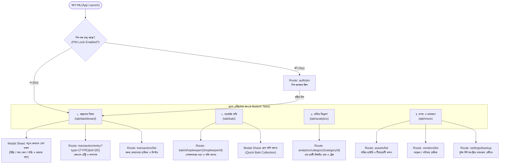

# 02_AppFlow.md — Screen-by-Screen State Machine & Navigation Architecture

**Project Name**: ব্যবসার হিসাব (Babshar Hisab)  
**Architecture Pattern**: Single-Activity (`MainActivity`) + Jetpack Compose Navigation (`NavHost`) + Unidirectional Data Flow (UDF / MVI State Machine)  

---

## 1. High-Level Navigation Architecture

The application uses a **4-Tab Bottom Navigation Bar (`BottomBar`)** paired with a context-aware **Primary Floating Action Button (FAB)** and modal bottom sheets / full-screen form destinations for ultra-fast data entry.

---

## 2. Complete Route Table (`AppDestination`)

| Route Pattern | Screen Name (Bangla) | Arguments | Purpose |
| :--- | :--- | :--- | :--- |
| `auth/pin` | `পিন আনলক` | None | Optional 4-digit local security lock |
| `tab/dashboard` | `আজকের হিসাব (হোম)` | None | Real-time operational dashboard, today's P&L, expense breakdown, recent transactions |
| `tab/baki` | `মার্কেটের বাকি (দোকানদার)` | None | Active market dues summary, searchable shopkeeper list sorted by highest due |
| `tab/analytics` | `মাসিক ও বার্ষিক বিশ্লেষণ` | None | Monthly income vs. expense bar charts, category donut chart, 6-month category trend lines |
| `tab/more` | `সম্পদ, মহাজন ও ব্যাকআপ` | None | Hub for Periodic Asset Maintenance, Vendor Directory, and Google Sheets Backup status |
| `transaction/entry?type={type}&id={id}` | `নতুন হিসাব এন্ট্রি` | `type`: `SALE`, `PURCHASE`, `EXPENSE`, `BAKI_COLLECT` `id`: Optional `String?` (for edit) | Unified, distraction-free keypad & form for recording sales, multi-vendor purchases, or transport/repair expenses |
| `transaction/list` | `সকল লেনদেনের খাতা` | `dateFrom`: `Long?`, `categoryId`: `String?` | Full searchable, filterable history of all transactions with edit/delete support |
| `baki/shopkeeper/{shopkeeperId}` | `দোকানদারের বিস্তারিত খাতা` | `shopkeeperId`: `String` | Complete chronological history of sales on credit and cash collections for one shopkeeper |
| `assets/list` | `সম্পদ ও ব্যাটারি রক্ষণাবেক্ষণ` | None | Manage periodic assets (battery, tires, engine overhaul), lifespan progress, and replacement logs |
| `vendors/list` | `মহাজন ও পাইকার তালিকা` | None | Directory of wholesale vendors and total purchase volume per vendor |
| `settings/backup` | `গুগল শিট ব্যাকআপ ও সেটিংস` | None | Configure Google Apps Script Web App URL, view sync queue, trigger manual sync, export CSV |

---

## 3. Screen-by-Screen State Machine (`UiState`, `UiEvent`, `UiEffect`)

Every screen follows a strict Unidirectional Data Flow (UDF) contract:
`ViewModel` exposes `StateFlow<ScreenUiState>`, receives `onEvent(ScreenEvent)`, and emits one-off navigation/snackbar events via `Channel<ScreenEffect>`.

### 3.1 Screen 1: Operational Dashboard (`tab/dashboard` — আজকের হিসাব)

- **Purpose**: Give the trader an instant, real-time picture of today's earnings, cash in hand, category-wise expenses, and market dues.
- **State Machine (`DashboardUiState`)**:
  - `Loading`: Initial SQLite query aggregation (typically `< 30ms`, shows shimmer skeleton only if needed).
  - `Ready`:
    - `selectedDate: LocalDate` (Defaults to Today `আজ`, with `< পূর্বের দিন` and `পরের দিন >` arrows).
    - `todayTotalSalesBdt: Long` (Total sales = Cash sales + New *Baki* given today).
    - `todayCashReceivedBdt: Long` (Cash sales + Previous *Baki* collected today).
    - `todayWholesalePurchaseBdt: Long` (Single or multiple vendor purchases today).
    - `todayOperatingExpenseBdt: Long` (Transport + Fuel + Food + Breakdown Repair).
    - `dailyAssetDepreciationBdt: Long` (Sum of daily amortized reserves across active assets).
    - `todayNetProfitBdt: Long` (`todayTotalSalesBdt - todayWholesalePurchaseBdt - todayOperatingExpenseBdt`).
    - `todayAdjustedProfitBdt: Long` (`todayNetProfitBdt - dailyAssetDepreciationBdt`).
    - `todayNetCashFlowBdt: Long` (`todayCashReceivedBdt - todayCashOutflowBdt`).
    - `totalActiveMarketBakiBdt: Long` (Global uncollected *Baki* across all shopkeepers).
    - `categoryBreakdown: List<CategorySpendItem>` (Category icon, Bangla name, total amount today, percentage of today's spend).
    - `recentTransactions: List<TransactionUiModel>` (Last 15 entries for the selected date).
    - `backupStatusBadge: BackupBadgeState` (`SYNCED`, `PENDING_COUNT(n)`, `SYNC_ERROR`, `NOT_CONFIGURED`).
- **Button Actions (`DashboardEvent`)**:
  - **Top Sync Pill Tap** -> Navigates to `settings/backup` or triggers immediate `WorkManager` one-time sync.
  - **Quick Action Bar (4 Large Prominent Buttons)**:
    1. `+ মাল কেনা (Purchase)` -> Opens `transaction/entry?type=PURCHASE`
    2. `+ গাড়ি ও দৈনিক খরচ (Expense)` -> Opens `transaction/entry?type=EXPENSE`
    3. `+ নগদ ও বাকি বিক্রি (Sale)` -> Opens `transaction/entry?type=SALE`
    4. `+ বাকি আদায় (Collect Due)` -> Opens Quick *Baki* Collection Sheet (`CollectBakiSheet`)
  - **Transaction Row Tap** -> Opens `transaction/entry?type={type}&id={id}` in Edit mode.
- **Empty State**:
  - Illustration + Bangla message: `"আজ এখনো কোনো লেনদেন লেখা হয়নি। নিচের বাটনে চাপ দিয়ে আজকের মাল কেনা বা বিক্রি যোগ করুন।"`

---

### 3.2 Screen 2: Unified Transaction & Expense Entry (`transaction/entry`)

- **Purpose**: Ultra-fast, error-free recording of Vendor Purchases, Transport/Fuel/Food/Repair Expenses, and Sales.
- **Mode Variants (`TransactionEntryMode`)**:
  1. **Wholesale Purchase (`মাল কেনা — পাইকারি ক্রয়`)**:
     - **Vendor Selector**: Horizontal scrollable chips of frequent Vendors (`মহাজন`) + `+ নতুন মহাজন` chip.
     - **Multi-Vendor Support**: A button `"একই দিনে আরেকজন মহাজনের কেনা যোগ করুন (Save & Add Another Vendor)"` allows rapid sequential entry across multiple vendors without leaving the screen.
     - **Amount Input**: Custom large Bangla/English numeric keypad (`৳`).
     - **Notes**: Optional item summary (e.g., `৫ বস্তা আলু, ২ কার্টন তেল`).
  2. **Operational Expense (`দৈনিক ও গাড়ির খরচ`)**:
     - **Category Grid (2x3 Large Icon Cards)**:
       - `যাতায়াত ও ভাড়া` (Transport/Toll)
       - `গাড়ির তেল / গ্যাস / চার্জ` (Fuel/CNG/Charging)
       - `খাবার ও নাস্তা ভাতা` (Food Allowance)
       - `গাড়ি মেরামত ও ব্রেকডাউন` (Vehicle Breakdown/Repair)
       - `সম্পদ ও ব্যাটারি রক্ষণাবেক্ষণ` (Periodic Asset Maintenance — links to an existing Asset if selected)
       - `অন্যান্য খরচ` (Other)
     - **Amount Input** (`৳`) + Optional Note.
  3. **Sales & Market *Baki* (`বিক্রি ও বাকি এন্ট্রি`)**:
     - Toggle between **দ্রুত নগদ বিক্রি (Quick Lump-Sum Cash Sale)** and **দোকানদারের কাছে বিক্রি (Shopkeeper Sale with Baki)**.
     - In Shopkeeper mode:
       - Select Shopkeeper (`দোকানদার নির্বাচন করুন`) or create inline (`নাম`, `মার্কেট/ঠিকানা`, `মোবাইল নম্বর`).
       - Input 1: `মোট বিক্রির বিল (Total Sale Amount ৳)`
       - Input 2: `নগদ জমা পেলেন (Cash Received Now ৳)` (Has a 1-tap `"পুরো টাকা নগদ"` button and `"পুরো টাকা বাকি"` button).
       - Read-only Auto-Calculated Box: `আজকের নতুন বাকি (New Baki Remaining)` = `Total - Cash Received`.
- **Validation & Error State Handling**:
  - If `Amount <= 0`: Shows inline Bangla error `"অনুগ্রহ করে সঠিক টাকার পরিমাণ লিখুন"` with gentle haptic feedback.
  - If `Cash Received > Total Bill` in Sale mode: Shows prompt `"নগদ জমার পরিমাণ মোট বিলের চেয়ে বেশি! অতিরিক্ত টাকা কি আগের বাকি থেকে কাটা হবে?"` (Automatically offers to apply excess cash to previous *Baki* balance!).
- **Offline Local Handling**:
  - Pressing `"হিসাব সেভ করুন (Save)"` executes an atomic Room `@Transaction`:
    1. Inserts into `transactions` table with `sync_status = 'PENDING'`.
    2. Updates `shopkeepers.current_baki_balance` (if applicable) with `sync_status = 'PENDING'`.
    3. Schedules a debounced `WorkManager` background sync job (`ExistingWorkPolicy.KEEP`).
    4. Navigates back immediately (`< 15ms` perceived latency).

---

### 3.3 Screen 3: Market Dues / *Baki* Ledger (`tab/baki` & `baki/shopkeeper/{id}`)

- **Purpose**: Prevent revenue leakage in the market by tracking every taka left in shopkeepers' hands.
- **State Machine (`BakiListUiState`)**:
  - **Top Summary Banner**:
    - `মার্কেটে মোট পাওনা (Total Market Receivable)`: Large bold Bangla currency (`৳ ৪৮,৫০০`).
    - `আজকের বাকি আদায় (Collected Today)`: (`৳ ৬,২০০`).
    - `মোট বাকিওয়ালা দোকান (Active Debtors)`: (`১৮ জন দোকানদার`).
  - **Search & Filter Bar**:
    - Search by Bangla or English phonetic name or Market name (`মার্কেট বা দোকানদারের নাম খুঁজুন...`).
    - Filter Chips: `সবাই (All)`, `বেশি বাকি (Highest Due)`, `পুরাতন বাকি (> ৭ দিন আদায় হয়নি)`.
  - **Shopkeeper Card Actions**:
    - Clicking `"বাকি আদায়"` button on any card opens the **Quick Collection Bottom Sheet**:
      - Shows current balance: `বর্তমান পাওনা: ৳ ৩,৫০০`.
      - Input: `আজ জমা দিলো (৳)`.
      - Auto-previews remaining balance: `নতুন বাকি থাকবে: ৳ ১,৫০০`.
      - One-tap `"হিসাব নিশ্চিত করুন"` saves a `BAKI_COLLECTION` transaction and updates the shopkeeper's balance atomically.
    - Clicking the card body opens `baki/shopkeeper/{shopkeeperId}` showing the full ledger table (`তারিখ | বিবরণ (মাল বিক্রি / নগদ জমা) | বিল | জমা | ব্যালেন্স`) plus a direct `"কল করুন (Call)"` button using `Intent.ACTION_DIAL`.

---

### 3.4 Screen 4: Analytical Dashboard (`tab/analytics` — মাসিক ও বার্ষিক বিশ্লেষণ)

- **Purpose**: Provide deep visibility into monthly financial trends, income vs. expense ratios, and category-level cost trends.
- **State Machine (`AnalyticsUiState`)**:
  - `selectedPeriod`: `THIS_MONTH (এই মাস)`, `LAST_MONTH (গত মাস)`, `LAST_3_MONTHS (গত ৩ মাস)`, `LAST_6_MONTHS (গত ৬ মাস)`, `YEARLY (এই বছর)`.
  - **KPI Summary Row**:
    - `মোট আয় (Total Revenue)`
    - `মোট খরচ (Total Expense: Goods + Ops)`
    - `নিট মুনাফা ও হার (Net Profit & Margin %)`
  - **Chart 1: Income vs. Expense Monthly/Weekly Trend (`আয় বনাম ব্যয় গ্রাফ`)**:
    - Interactive Compose Canvas Bar/Line Chart comparing Income (Emerald Green) vs. Total Expense (Coral Red) across weeks or months.
  - **Chart 2: Category Expense Breakdown (`খাতওয়ারী খরচের অনুপাত`)**:
    - Donut chart + ranked list showing % share of Wholesale Purchases, Vehicle Fuel, Transport, Food Allowance, Breakdown Repairs, and Asset Maintenance.
  - **Chart 3: Category Trend Line (`নির্দিষ্ট খরচের মাসিক প্রবণতা`)**:
    - Filter chips for individual expense categories (e.g., `গাড়ির তেল`, `গাড়ি মেরামত`, `খাবার ভাতা`).
    - Plots a 6-month trend line so the trader can immediately spot if vehicle fuel or breakdown costs are rising month-over-month (signaling an aging vehicle or route inefficiency).

---

### 3.5 Screen 5: Periodic Asset Maintenance & Battery Tracker (`assets/list`)

- **Purpose**: Track multi-year or multi-month capital assets (e.g., replacing an auto/van battery every 2 years, tires every 18 months, engine overhaul every 12 months).
- **State Machine (`AssetListUiState`)**:
  - **Total Monthly & Daily Depreciation Card**:
    - Shows how much money the trader should mentally or physically set aside every day (`দৈনিক অবচয় সঞ্চয়: ৳ ৩৫/দিন`) to afford future battery/tire replacements without a cash crisis.
  - **Asset Cards**:
    - Example: `গাড়ির ব্যাটারি (৪টি সেট)` — Cost: `৳ ৩৬,০০০`, Lifespan: `২৪ মাস (২ বছর)`.
    - Purchase Date: `১০ জানুয়ারি ২০২৫` | Next Replacement Due: `১০ জানুয়ারি ২০২৭`.
    - Visual Health/Lifecycle Progress Bar: Green (`0–70%` elapsed), Amber (`70–90%` elapsed), Red (`>90%` or Overdue — `"পরিবর্তনের সময় হয়েছে!"`).
    - Action Button: `"নতুন পরিবর্তন/মেরামত রেকর্ড করুন (Log Replacement)"` -> Resets cycle date, updates replacement cost, and logs a capital expense transaction.

---

### 3.6 Screen 6: Automated Google Sheets Backup (`settings/backup`)

- **Purpose**: Configure, monitor, and manually trigger the `WorkManager` daily Google Sheets backup.
- **State Machine (`BackupSettingsUiState`)**:
  - `webAppUrl: String` (User's Google Apps Script Web App Deployment URL or scanned via QR/paste).
  - `secretToken: String` (Optional shared secret key verified by the Apps Script to prevent unauthorized writes).
  - `autoBackupEnabled: Boolean` (Default: `true` once URL is provided).
  - `pendingSyncCount: Int` (Count of rows across `transactions`, `shopkeepers`, `assets`, `vendors` where `sync_status != 'SYNCED'`).
  - `lastSyncTimestamp: Long?` (Formatted in Bangla: `১৩ নভেম্বর ২০২৬, রাত ১০:৩০`).
  - `lastSyncError: String?` (Human-friendly Bangla message if network or URL failed).
- **User Actions**:
  - `"এখনই ব্যাকআপ নিন (Backup Now)"`: Enqueues an expedited/immediate `OneTimeWorkRequest` via `WorkManager` and observes `WorkInfo.State` live (`RUNNING` -> `SUCCEEDED` / `FAILED`).
  - `"গুগল শিট সেটআপ গাইড দেখুন"`: Built-in offline Bangla step-by-step guide + 1-tap `"স্ক্রিপ্ট কোড কপি করুন (Copy Apps Script Code)"` so the user or developer can paste the ready-made Google Apps Script directly into any Google Sheet in 60 seconds.
  - `"অফলাইন এক্সেল/সিএসভি ফাইল ডাউনলোড করুন"`: Local fallback export to the device's `Downloads/` folder.

---

## 4. Offline-First & Edge-Case Handling Rules

1. **Zero Network Dependency on UI Thread**:
   - No screen may ever block, show a blocking spinner, or disable "Save" when the device is offline.
   - All reads come exclusively from Room `Flow<T>` queries. All writes commit to Room first.
2. **Idempotent Sync Queue**:
   - Every entity has a `uuid` (UUID v4 primary key), `updated_at` (epoch millis), `is_deleted` (soft-delete tombstone), and `sync_status` (`PENDING`, `SYNCED`, `FAILED`).
   - Editing or deleting a previously synced transaction flips `sync_status` back to `PENDING` and increments `version`, ensuring the next Google Sheets sync updates the existing row in Google Sheets rather than duplicating it.
3. **Midnight Date Rollover Handling**:
   - Traders working late nights (e.g., returning from a wholesale market at 12:30 AM) can explicitly pick `"আজ (Today)"` or `"গতকাল (Yesterday)"` via a 1-tap toggle at the top of the Transaction Entry screen so late-night entries can be attributed to the correct business trip date.
