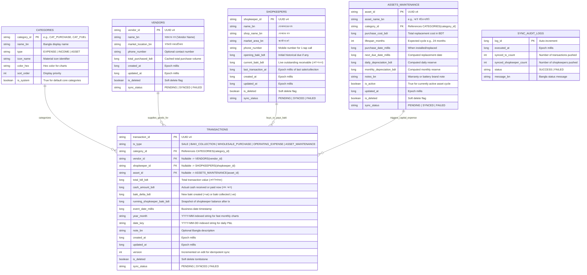

# 05_Schema.md — Complete Relational Database Schema (Room SQLite)

**Database Name**: `babshar_hisab.db`  
**Schema Version**: `1` (`exportSchema = true`)  
**Engine**: Android Room SQLite with `JournalMode.WRITE_AHEAD_LOGGING` and Foreign Key enforcement (`PRAGMA foreign_keys = ON`)  

---

## 1. Entity-Relationship Diagram (ERD)



---

## 2. Detailed Table Definitions & DDL Specifications

### 2.1 Table 1: `categories` (`CategoryEntity.kt`)
Stores the pre-seeded Bangla operational categories and any user-created custom categories.

| Column Name | SQLite Type | Kotlin Type | Constraints | Description |
| :--- | :--- | :--- | :--- | :--- |
| `category_id` | `TEXT` | `String` | `PRIMARY KEY NOT NULL` | Deterministic ID for system categories (e.g., `CAT_PURCHASE`, `CAT_FUEL`), UUID for custom |
| `name_bn` | `TEXT` | `String` | `NOT NULL` | Bangla display label (e.g., `গাড়ির তেল / জ্বালানি`) |
| `type` | `TEXT` | `String` | `NOT NULL` | `PURCHASE`, `EXPENSE`, `SALE`, `BAKI_COLLECT`, `ASSET` |
| `icon_name` | `TEXT` | `String` | `NOT NULL` | Identifier mapped to Compose Material Icon |
| `color_hex` | `TEXT` | `String` | `NOT NULL` | Hex string (e.g., `#EA580C`) for chart consistency |
| `sort_order` | `INTEGER` | `Int` | `NOT NULL DEFAULT 0` | Controls grid ordering |
| `is_system` | `INTEGER` | `Boolean` | `NOT NULL DEFAULT 1` | `1` = Immutable pre-seeded category; `0` = User-created |

**Pre-Seeded System Rows (Inserted on Database Creation)**:
1. `CAT_SALE` | `পণ্য বিক্রি (নগদ ও বাকি)` | `SALE` | `PointOfSale` | `#059669` | `1`
2. `CAT_BAKI_COLLECT` | `বাকি আদায় (দোকানদার জমা)` | `BAKI_COLLECT` | `Payments` | `#D97706` | `2`
3. `CAT_PURCHASE` | `মাল কেনা (পাইকারি ক্রয়)` | `PURCHASE` | `Inventory2` | `#2563EB` | `3`
4. `CAT_FUEL` | `গাড়ির জ্বালানি / তেল / চার্জ` | `EXPENSE` | `LocalGasStation` | `#EA580C` | `4`
5. `CAT_TRANSPORT` | `যাতায়াত, ভাড়া ও টোল` | `EXPENSE` | `LocalShipping` | `#7C3AED` | `5`
6. `CAT_FOOD` | `খাবার ও নাস্তা ভাতা` | `EXPENSE` | `Restaurant` | `#0D9488` | `6`
7. `CAT_REPAIR` | `গাড়ি মেরামত ও ব্রেকডাউন` | `EXPENSE` | `CarRepair` | `#E11D48` | `7`
8. `CAT_ASSET` | `সম্পদ ও ব্যাটারি রক্ষণাবেক্ষণ` | `ASSET` | `BatteryChargingFull` | `#4F46E5` | `8`
9. `CAT_OTHER` | `অন্যান্য খরচ` | `EXPENSE` | `ReceiptLong` | `#64748B` | `9`

---

### 2.2 Table 2: `vendors` (`VendorEntity.kt` — মহাজন / পাইকার)
Supports purchasing goods from a single wholesale vendor or multiple vendors on the same day.

| Column Name | SQLite Type | Kotlin Type | Constraints | Description |
| :--- | :--- | :--- | :--- | :--- |
| `vendor_id` | `TEXT` | `String` | `PRIMARY KEY NOT NULL` | UUID v4 |
| `name_bn` | `TEXT` | `String` | `NOT NULL` | મહাজনের নাম (e.g., `হাজী ট্রেডার্স — রহিম সাহেব`) |
| `market_location_bn` | `TEXT` | `String` | `NOT NULL DEFAULT ''` | পাইকারি আড়ত বা বাজার (e.g., `কারওয়ান বাজার / শ্যামবাজার`) |
| `phone_number` | `TEXT` | `String` | `NOT NULL DEFAULT ''` | Optional contact phone |
| `total_purchased_bdt` | `INTEGER` | `Long` | `NOT NULL DEFAULT 0` | Cumulative purchase volume for sorting frequent vendors first |
| `created_at` | `INTEGER` | `Long` | `NOT NULL` | Epoch milliseconds |
| `updated_at` | `INTEGER` | `Long` | `NOT NULL` | Epoch milliseconds |
| `is_deleted` | `INTEGER` | `Boolean` | `NOT NULL DEFAULT 0` | Soft-delete flag |
| `sync_status` | `TEXT` | `String` | `NOT NULL DEFAULT 'PENDING'` | `PENDING`, `SYNCED`, `FAILED` |

**Indexes**:
- ` index_vendors_sync_status ON vendors(sync_status)`
- ` index_vendors_total_purchased ON vendors(is_deleted, total_purchased_bdt DESC)`

---

### 2.3 Table 3: `shopkeepers` (`ShopkeeperEntity.kt` — মার্কেটের দোকানদার ও বাকি খাতা)
Tracks every market customer/shopkeeper and their real-time outstanding *Baki* (receivable balance).

| Column Name | SQLite Type | Kotlin Type | Constraints | Description |
| :--- | :--- | :--- | :--- | :--- |
| `shopkeeper_id` | `TEXT` | `String` | `PRIMARY KEY NOT NULL` | UUID v4 |
| `name_bn` | `TEXT` | `String` | `NOT NULL` | দোকানদারের নাম |
| `shop_name_bn` | `TEXT` | `String` | `NOT NULL DEFAULT ''` | দোকানের নাম (e.g., `বিসমিল্লাহ স্টোর`) |
| `market_area_bn` | `TEXT` | `String` | `NOT NULL DEFAULT ''` | মার্কেট বা এলাকার নাম |
| `phone_number` | `TEXT` | `String` | `NOT NULL DEFAULT ''` | Mobile number for 1-tap dial |
| `opening_baki_bdt` | `INTEGER` | `Long` | `NOT NULL DEFAULT 0` | Initial balance when onboarding existing paper khata |
| `current_baki_bdt` | `INTEGER` | `Long` | `NOT NULL DEFAULT 0` | Current live uncollected due (`মোট পাওনা টাকা`) |
| `last_transaction_at` | `INTEGER` | `Long` | `NOT NULL DEFAULT 0` | Timestamp of most recent sale or *Baki* collection |
| `created_at` | `INTEGER` | `Long` | `NOT NULL` | Epoch milliseconds |
| `updated_at` | `INTEGER` | `Long` | `NOT NULL` | Epoch milliseconds |
| `is_deleted` | `INTEGER` | `Boolean` | `NOT NULL DEFAULT 0` | Soft-delete flag |
| `sync_status` | `TEXT` | `String` | `NOT NULL DEFAULT 'PENDING'` | `PENDING`, `SYNCED`, `FAILED` |

**Indexes**:
- `index_shopkeepers_baki_balance ON shopkeepers(is_deleted, current_baki_bdt DESC)`
- `index_shopkeepers_sync_status ON shopkeepers(sync_status)`

---

### 2.4 Table 4: `assets_maintenance` (`AssetMaintenanceEntity.kt` — দীর্ঘমেয়াদী সম্পদ ও ব্যাটারি হিসাব)
Tracks periodic high-cost capital assets (such as replacing a vehicle battery every 24 months or tires every 18 months) and computes daily/monthly depreciation reserves.

| Column Name | SQLite Type | Kotlin Type | Constraints | Description |
| :--- | :--- | :--- | :--- | :--- |
| `asset_id` | `TEXT` | `String` | `PRIMARY KEY NOT NULL` | UUID v4 |
| `asset_name_bn` | `TEXT` | `String` | `NOT NULL` | e.g., `গাড়ির ব্যাটারি সেট (২ বছর মেয়াদী)` |
| `category_id` | `TEXT` | `String` | `NOT NULL DEFAULT 'CAT_ASSET'` | Foreign key to `categories(category_id)` |
| `purchase_cost_bdt` | `INTEGER` | `Long` | `NOT NULL` | Cost in BDT (e.g., `24000`) |
| `lifespan_months` | `INTEGER` | `Int` | `NOT NULL` | Expected lifespan in months (e.g., `24` for 2 years) |
| `purchase_date_millis` | `INTEGER` | `Long` | `NOT NULL` | Date of installation/replacement |
| `next_due_date_millis` | `INTEGER` | `Long` | `NOT NULL` | Computed target date (`purchase_date + lifespan_months`) |
| `daily_depreciation_bdt` | `INTEGER` | `Long` | `NOT NULL` | `round(purchase_cost_bdt / (lifespan_months * 30.4375))` |
| `monthly_depreciation_bdt`| `INTEGER` | `Long` | `NOT NULL` | `round(purchase_cost_bdt / lifespan_months)` |
| `notes_bn` | `TEXT` | `String` | `NOT NULL DEFAULT ''` | Warranty card note, shop name |
| `is_active` | `INTEGER` | `Boolean` | `NOT NULL DEFAULT 1` | `1` = Currently in use; `0` = Archived/Replaced |
| `updated_at` | `INTEGER` | `Long` | `NOT NULL` | Epoch milliseconds |
| `is_deleted` | `INTEGER` | `Boolean` | `NOT NULL DEFAULT 0` | Soft-delete flag |
| `sync_status` | `TEXT` | `String` | `NOT NULL DEFAULT 'PENDING'` | `PENDING`, `SYNCED`, `FAILED` |

**Indexes**:
- `index_assets_active_due ON assets_maintenance(is_deleted, is_active, next_due_date_millis ASC)`
- `index_assets_sync_status ON assets_maintenance(sync_status)`

---

### 2.5 Table 5: `transactions` (`TransactionEntity.kt` — মূল লেনদেন খাতা)
The immutable-style central financial ledger recording every sale, *Baki* collection, wholesale purchase, daily operational cost, and capital asset maintenance event.

| Column Name | SQLite Type | Kotlin Type | Constraints | Description |
| :--- | :--- | :--- | :--- | :--- |
| `transaction_id` | `TEXT` | `String` | `PRIMARY KEY NOT NULL` | UUID v4 |
| `tx_type` | `TEXT` | `String` | `NOT NULL` | Enum: `SALE`, `BAKI_COLLECTION`, `WHOLESALE_PURCHASE`, `OPERATING_EXPENSE`, `ASSET_MAINTENANCE` |
| `category_id` | `TEXT` | `String` | `NOT NULL` | FK -> `categories(category_id)` (`ON DELETE RESTRICT`) |
| `vendor_id` | `TEXT` | `String?` | `NULLABLE` | FK -> `vendors(vendor_id)` (`ON DELETE SET NULL`) |
| `shopkeeper_id` | `TEXT` | `String?` | `NULLABLE` | FK -> `shopkeepers(shopkeeper_id)` (`ON DELETE SET NULL`) |
| `asset_id` | `TEXT` | `String?` | `NULLABLE` | FK -> `assets_maintenance(asset_id)` (`ON DELETE SET NULL`) |
| `total_bill_bdt` | `INTEGER` | `Long` | `NOT NULL` | Full value of sale, purchase, or expense (`মোট বিল বা খরচ`) |
| `cash_amount_bdt` | `INTEGER` | `Long` | `NOT NULL` | Actual cash received or paid out immediately (`নগদ লেনদেন`) |
| `baki_delta_bdt` | `INTEGER` | `Long` | `NOT NULL DEFAULT 0` | `+ve` when new *Baki* is left on a Sale (`total_bill - cash`); `-ve` when *Baki* is collected (`-cash_amount`) |
| `running_shopkeeper_baki_bdt` | `INTEGER` | `Long` | `NOT NULL DEFAULT 0` | Snapshot of shopkeeper's balance immediately after this transaction |
| `event_date_millis` | `INTEGER` | `Long` | `NOT NULL` | Business date & time of the transaction |
| `date_key` | `TEXT` | `String` | `NOT NULL` | `YYYY-MM-DD` in local Bangladesh time (`Asia/Dhaka`) for instant daily grouping |
| `year_month` | `TEXT` | `String` | `NOT NULL` | `YYYY-MM` in local Bangladesh time for instant monthly analytics grouping |
| `note_bn` | `TEXT` | `String` | `NOT NULL DEFAULT ''` | Optional Bangla note (e.g., `চাকা পাংচার ও টিউব পরিবর্তন`) |
| `created_at` | `INTEGER` | `Long` | `NOT NULL` | Creation epoch millis |
| `updated_at` | `INTEGER` | `Long` | `NOT NULL` | Last modification epoch millis |
| `version` | `INTEGER` | `Int` | `NOT NULL DEFAULT 1` | Incremented on every edit |
| `is_deleted` | `INTEGER` | `Boolean` | `NOT NULL DEFAULT 0` | Soft-delete tombstone (synced to Sheets so deleted rows are removed/marked) |
| `sync_status` | `TEXT` | `String` | `NOT NULL DEFAULT 'PENDING'` | `PENDING`, `SYNCED`, `FAILED` |

**Indexes (Engineered for Sub-10ms Dashboard & Analytics Queries)**:
1. `index_tx_date_key ON transactions(is_deleted, date_key, tx_type)` — Powers the Real-Time Operational Dashboard (`tab/dashboard`).
2. `index_tx_year_month_cat ON transactions(is_deleted, year_month, category_id)` — Powers the Monthly Analytical Dashboard & Category Trend Lines (`tab/analytics`).
3. `index_tx_shopkeeper_ledger ON transactions(is_deleted, shopkeeper_id, event_date_millis DESC)` — Powers the Shopkeeper *Baki* statement (`baki/shopkeeper/{id}`).
4. `index_tx_vendor_ledger ON transactions(is_deleted, vendor_id, event_date_millis DESC)` — Powers Multi-Vendor purchase history.
5. `index_tx_sync_queue ON transactions(sync_status, updated_at ASC)` — Powers `GoogleSheetsBackupWorker` delta queries.

---

### 2.6 Table 6: `sync_audit_logs` (`SyncLogEntity.kt`)
Stores the local history of background and manual Google Sheets backups.

| Column Name | SQLite Type | Kotlin Type | Constraints | Description |
| :--- | :--- | :--- | :--- | :--- |
| `log_id` | `INTEGER` | `Long` | `PRIMARY KEY AUTOINCREMENT` | Sequential ID |
| `executed_at` | `INTEGER` | `Long` | `NOT NULL` | Epoch millis |
| `synced_records_count` | `INTEGER` | `Int` | `NOT NULL` | Total items synced in this batch |
| `status` | `TEXT` | `String` | `NOT NULL` | `SUCCESS` or `FAILED` |
| `message_bn` | `TEXT` | `String` | `NOT NULL` | User-readable Bangla summary |

---

## 3. Core SQL Aggregation Formulas (Single Source of Truth)

To guarantee zero discrepancy between the Operational Dashboard, the Analytical Dashboard, and the Google Sheets Daily Summary tab, all modules MUST use these exact SQL formulas:

1. **Total Sales Revenue (`মোট বিক্রি — নগদ ও বাকি সহ`) for a Period**:
   ```sql
   SELECT COALESCE(SUM(total_bill_bdt), 0)
   FROM transactions
   WHERE is_deleted = 0 AND tx_type = 'SALE' AND date_key = :dateKey
   ```
2. **Realized Cash Inflow (`মোট নগদ ক্যাশ জমা — নগদ বিক্রি + আগের বাকি আদায়`)**:
   ```sql
   SELECT COALESCE(SUM(cash_amount_bdt), 0)
   FROM transactions
   WHERE is_deleted = 0 AND tx_type IN ('SALE', 'BAKI_COLLECTION') AND date_key = :dateKey
   ```
3. **Total Wholesale Purchases (`মাল কেনা / পাইকারি ক্রয়`)**:
   ```sql
   SELECT COALESCE(SUM(total_bill_bdt), 0)
   FROM transactions
   WHERE is_deleted = 0 AND tx_type = 'WHOLESALE_PURCHASE' AND date_key = :dateKey
   ```
4. **Total Operational Expenses (`গাড়ি, তেল, যাতায়াত, খাবার ও মেরামত খরচ`)**:
   ```sql
   SELECT COALESCE(SUM(total_bill_bdt), 0)
   FROM transactions
   WHERE is_deleted = 0 AND tx_type = 'OPERATING_EXPENSE' AND date_key = :dateKey
   ```
5. **Net Operational Profit / Loss (`আজকের নিট লাভ / ক্ষতি`)**:
   $$\text{Net Profit} = \text{Total Sales Revenue} - (\text{Total Wholesale Purchases} + \text{Total Operational Expenses})$$
6. **Adjusted Net Profit Including Periodic Asset Depreciation (`অবচয় বাদে প্রকৃত লাভ`)**:
   $$\text{Adjusted Net Profit} = \text{Net Profit} - \sum_{\text{active assets}} \text{daily\_depreciation\_bdt}$$
7. **Active Market Dues (`মার্কেটে মোট বকেয়া পাওনা`)**:
   ```sql
   SELECT COALESCE(SUM(current_baki_bdt), 0)
   FROM shopkeepers
   WHERE is_deleted = 0 AND current_baki_bdt > 0
   ```
